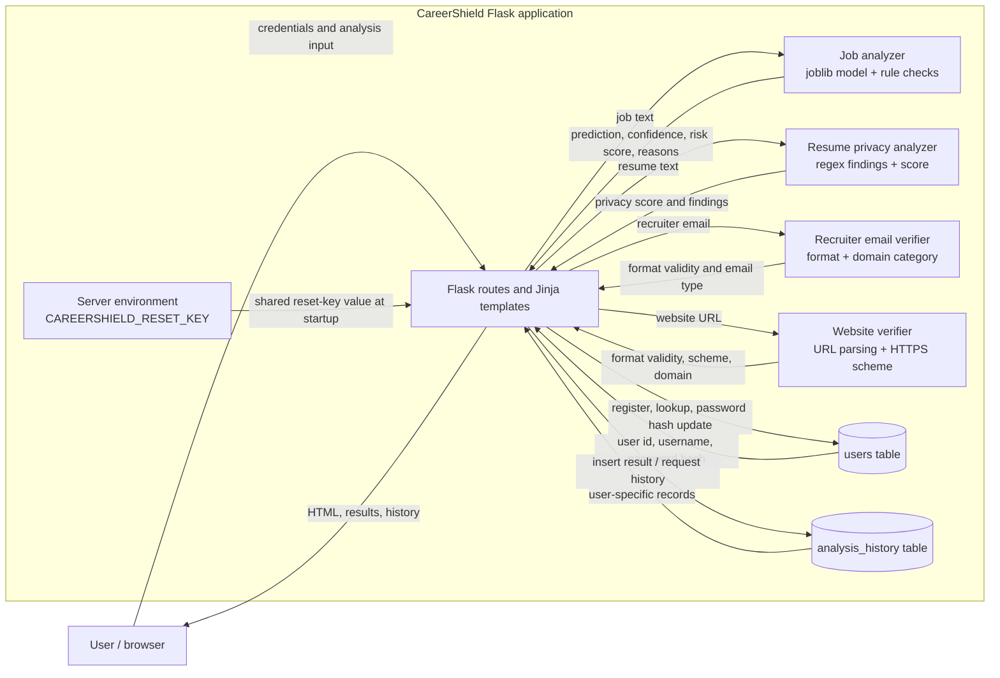
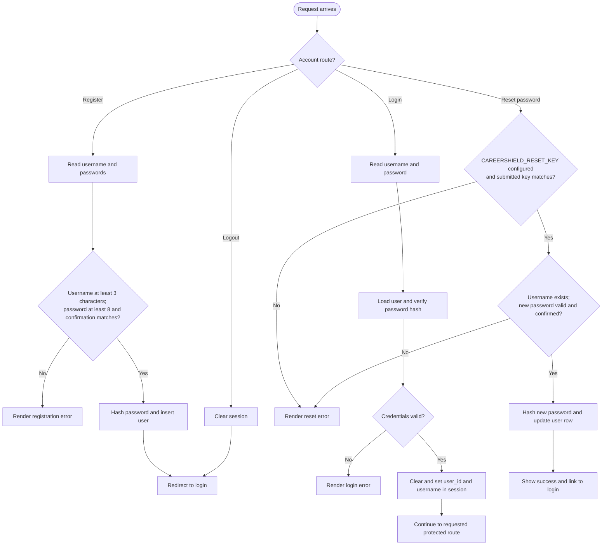
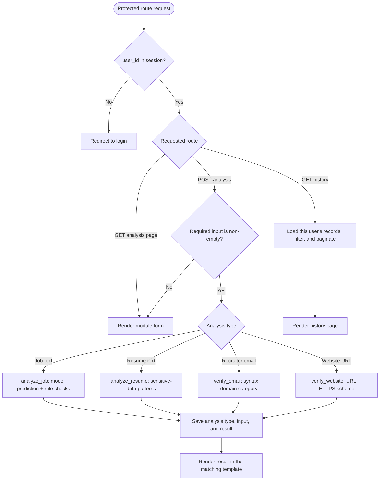

# System Design - DFD and Flowchart

These diagrams describe the current implementation in `app.py`, the analyzer modules, and `history_db.py`.

## Data Flow Diagram

The application does not send password-reset email, perform DNS/domain ownership checks, or fetch websites. The website verifier parses the URL and checks its scheme only. Flask session data is kept in a signed browser cookie; passwords are stored as Werkzeug password hashes. The reset key is read from the server environment and is not stored in SQLite.

## Flowcharts

### Account and Session Flow

### Protected Analysis Flow

Analysis results are saved only after a non-empty analysis submission. Loading a form or viewing history does not create an analysis record.
