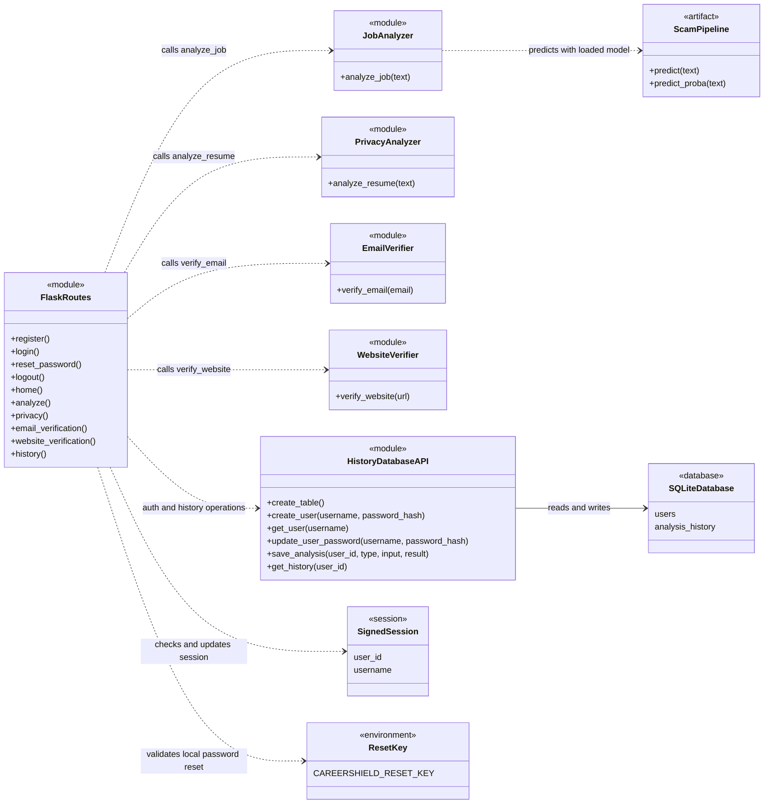
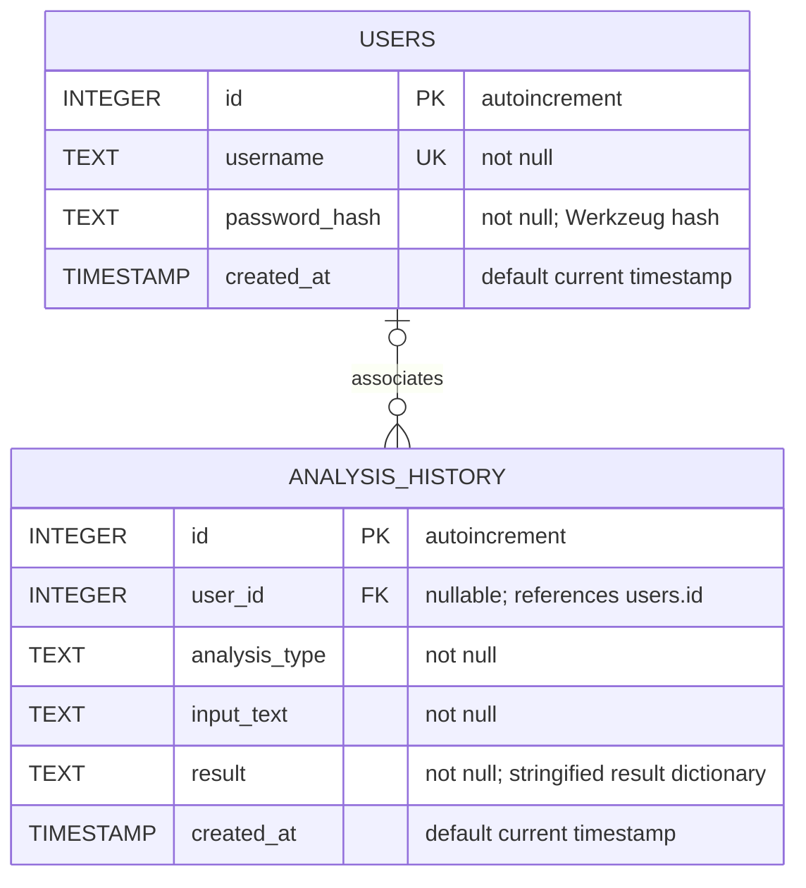

# System Design - UML and ER Diagram

This design reflects the current function-based Flask application. The UML view models source modules as components because the project does not define application classes for these services.

## UML Component View

`ScamPipeline` is loaded from `models/scam_pipeline.joblib`; it is a TF-IDF and Logistic Regression pipeline. The analyzer modules are Python functions, not separately instantiated service classes.

## Entity-Relationship Diagram

A user may have zero or many history records; a history record may have no associated user because `user_id` is nullable. The schema declares the foreign key, although SQLite foreign-key enforcement is not enabled explicitly by the current connection code. User accounts do not store an email address, and password-reset keys/tokens are not persisted in the database.
